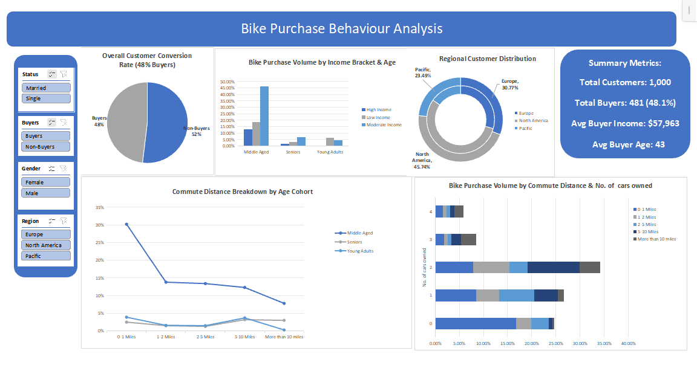
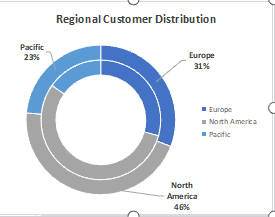
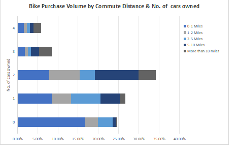

# Bike Purchase Behaviour Analysis — Project Report

## 1. Project Overview

This project analyses customer demographic, financial, regional, and commuting data to explore patterns associated with bike purchasing behaviour. Microsoft Excel was used for data cleaning, transformation, PivotTable analysis, and dashboard development.

The objective was to identify customer segments and purchasing patterns that could help a business make more informed decisions about marketing, customer segmentation, and regional strategy.

### Business Question

**How can customer demographic and commuting data be used to identify bike purchasing patterns and inform marketing strategies?**

### Tools Used

- Microsoft Excel
- Excel Tables and formulas
- PivotTables and PivotCharts
- Interactive dashboard slicers

## 2. Dataset Overview

The dataset contains customer information, including demographic characteristics, income, geographic region, commuting distance, vehicle ownership, and bike purchase status.

The analysis examines relationships between these variables and purchasing behaviour to identify patterns within the customer base.

## 3. Data Preparation

Data preparation was conducted in a separate working sheet to preserve the original dataset.

The following steps were completed:

- Created a working sheet for data cleaning and transformation.
- Removed duplicate records from the working dataset.
- Standardised marital status values from `S` and `M` to `Single` and `Married`, respectively.
- Standardised gender values from `F` and `M` to `Female` and `Male`, respectively.
- Created age brackets to group customers into three categories.
- Created income brackets to support comparisons across income levels.
- Created PivotTables to summarise purchasing behaviour across relevant customer attributes.

### Age Segmentation

Customers were grouped into three age categories:

| Age Range | Age Bracket |
|---|---|
| 30 and below | Young Adults |
| 31–59 | Middle-Aged |
| 60 and above | Seniors |

The age categories were created using an Excel formula:

```excel
=IF(M897>=60,"Seniors",IF(M897>30,"Middle-Aged",IF(M897<=30,"Young Adults")))
```

### Income Segmentation

Customers were grouped into three income categories:

| Income Range | Income Bracket |
|---|---|
| Below $40,000 | Low Income |
| $40,000–$80,000 | Moderate Income |
| Above $80,000 | High Income |

These categories made it easier to compare bike purchasing patterns across income levels.

## 4. Analysis and Dashboard Development

PivotTables and PivotCharts were used to analyse bike purchasing behaviour across customer segments. An interactive dashboard was developed to bring the results together in a single view.

The dashboard includes summary metrics, charts, and slicers that allow users to explore the data by selected customer characteristics.

### Key Performance Indicators

The dashboard presents the following summary metrics:

- Total number of customers
- Number of bike buyers
- Number of non-buyers
- Average income of buyers compared with non-buyers
- Average age of buyers compared with non-buyers

### Interactive Filters

Slicers were added to allow users to filter the dashboard by available customer attributes, including marital status, bike purchase status, gender, and region. The slicers were connected to the relevant PivotTables and PivotCharts to support interactive analysis.

### Dashboard Visualisations

The dashboard includes the following visualisations:

1. **Bike Purchase Distribution:** Compares buyers and non-buyers.
2. **Purchase Patterns by Age and Income:** Examines bike purchasing across age and income segments.
3. **Regional Customer Distribution:** Shows how customers are distributed across geographic regions.
4. **Commute Distance by Age Group:** Explores differences in commuting distance across age groups.
5. **Commute Distance and Vehicle Ownership:** Examines the distribution of bike buyers across commute-distance and vehicle-ownership categories.



*Figure 1: Interactive Excel dashboard showing bike purchase patterns across customer segments.*

## 5. Key Findings

### 5.1 Overall Bike Purchase Distribution

The dataset contains 1,000 customer records, with the following purchase distribution:

| Metric | Result |
|---|---:|
| Total Customers | 1,000 |
| Bike Buyers | 481 |
| Non-Buyers | 519 |
| Buyer Share | 48.1% |
| Non-Buyer Share | 51.9% |

Bike buyers account for 48.1% of the customer records, while non-buyers account for 51.9%. The two groups are relatively close in size, with non-buyers representing a slightly larger share of the dataset.

This distribution provides a baseline for investigating how purchasing patterns differ across demographic and behavioural segments.

### 5.2 Income and Age Differences

The analysis identified differences in average income and age between buyers and non-buyers.

| Metric | Bike Buyers | Non-Buyers |
|---|---:|---:|
| Average Income | $57,963 | $54,875 |
| Average Age | 43 | 45 |

On average, bike buyers had higher incomes and were younger than non-buyers. These differences describe the two groups but do not establish that income or age independently causes a purchase.

Further analysis of purchase rates within individual age and income categories would help determine which segments are more likely to purchase a bike.

### 5.3 Age and Income Segmentation

The middle-aged, moderate-income segment accounted for **53.01% of all bike buyers**.

This represents a substantial share of the existing buyer group and makes the segment worth investigating further. However, the figure represents the segment's share of all buyers, not its purchase rate. It therefore does not, on its own, demonstrate that customers in this segment are more likely to buy bikes than customers in other segments.

Comparing the number of buyers with the total number of customers in each age and income segment would provide a clearer basis for evaluating purchase likelihood.

### 5.4 Regional Purchasing Patterns

The distribution of bike buyers across regions was as follows:

| Region | Share of All Bike Buyers |
|---|---:|
| North America | 45.74% |
| Europe | 30.77% |
| Pacific | 23.49% |

North America accounted for the largest share of all bike buyers, followed by Europe and the Pacific region.

The Pacific region recorded the highest reported regional purchase rate, at approximately 57.9%. This provides a different perspective from buyer distribution: North America contributed the largest share of buyers, while the Pacific region had the highest reported proportion of customers purchasing bikes within the region.

These measures answer different questions. Buyer share indicates where existing buyers are concentrated, while regional purchase rate indicates the proportion of customers in a region who purchased a bike.



*Figure 2: Regional comparison of customer and bike purchasing patterns.*

### 5.5 Commute Distance and Bike Purchasing

The analysis showed differences in the distribution of bike buyers across commute-distance categories. Shorter commute distances featured prominently in the buyer distribution, while fewer buyers were represented among customers with longer commutes.

This pattern suggests that commute distance may be a useful variable for customer segmentation and further investigation.

However, the distribution of buyers across commute distances does not, by itself, show the likelihood of purchasing a bike at each distance. To establish that, the number of buyers in each commute category must be compared with the total number of customers in that same category.

The analysis also examined commute-distance patterns across age groups to explore how these characteristics varied among customers.

### 5.6 Vehicle Ownership

Customers owning zero or one car accounted for approximately **62.99% of all bike buyers**.

This indicates that households with zero or one car represented a substantial portion of the existing buyer group. It does not necessarily mean that these households have a higher purchase rate than households with more cars.

Comparing the number of buyers against the total number of customers within each vehicle-ownership category would help determine whether purchase likelihood differs by car ownership.



*Figure 3: Bike buyer distribution across commute-distance and vehicle-ownership categories.*

## 6. Business Recommendations

Based on the observed patterns, the following actions could be explored.

### 6.1 Explore Marketing for Short-Distance Commuters

Consider testing marketing messages that position bikes as a convenient option for short-distance journeys. The observed buyer distribution suggests this group may be worth investigating, although purchase rates should be compared across commute categories before allocating substantial resources.

### 6.2 Investigate the Middle-Aged, Moderate-Income Segment

The segment accounted for 53.01% of all bike buyers. Further analysis could examine its preferences, purchasing characteristics, and purchase rate relative to other customer groups before developing targeted campaigns.

### 6.3 Evaluate Customers by Vehicle Ownership

Customers owning zero or one car accounted for approximately 62.99% of all bike buyers. The business could investigate whether this group has a higher purchase rate and whether different marketing messages are appropriate for customers with different levels of vehicle ownership.

### 6.4 Use Region-Specific Strategies

North America accounted for the largest share of bike buyers, while the Pacific region had the highest reported regional purchase rate.

A regional strategy could therefore consider the size of the existing buyer base alongside the purchase rate in each region. Further investigation into regional customer preferences, market size, and sales performance would help determine where different marketing approaches may be most effective.

### 6.5 Improve Customer Segmentation

Combining demographic, income, commuting, and vehicle-ownership attributes could help the business develop more useful customer segments. Purchase rates should be calculated for each segment to distinguish groups that contribute many existing buyers from groups that have a comparatively high likelihood of purchasing.

## 7. Limitations

Several limitations should be considered when interpreting the findings:

- The analysis identifies patterns and associations; it does not establish causal relationships.
- The share of all buyers within a segment is different from the purchase rate within that segment.
- Differences in average age and income do not establish that these characteristics independently influence purchasing decisions.
- The findings are based on the available dataset and may not represent customers outside it.
- Recommendations are proposed actions for further investigation, rather than strategies whose effectiveness has already been tested.

## 8. Conclusion

This project used Microsoft Excel to prepare customer data, create demographic and income categories, analyse bike purchasing patterns, and develop an interactive dashboard.

The analysis found that 48.1% of the 1,000 customer records represented bike buyers. Buyers had a higher average income and a lower average age than non-buyers. The middle-aged, moderate-income segment accounted for 46.1% of all bike buyers, while customers owning zero or one car accounted for approximately 62.99% of buyers. Regional analysis also showed that North America contributed the largest share of buyers, whereas the Pacific region had the highest reported regional purchase rate.

These findings provide a starting point for customer segmentation and marketing decisions. Calculating purchase rates within each customer group and testing targeted strategies would help determine which patterns offer the strongest opportunities for the business.

## 9. Project Files

- `README.md` — Project overview and quick summary.
- `Project_report.md` — Detailed analysis, findings, recommendations, and limitations.
- `Bike_Purchase_Analysis.xlsx` — Excel workbook containing the prepared data, PivotTables, and dashboard.
- `images/` — Screenshots used to illustrate the project.

## 10. Skills Demonstrated

- Data cleaning and standardisation
- Excel formulas and calculated columns
- Data categorisation and segmentation
- PivotTables and PivotCharts
- Interactive dashboard development
- Exploratory data analysis
- Business-oriented interpretation of data
- Communicating findings and recommendations
